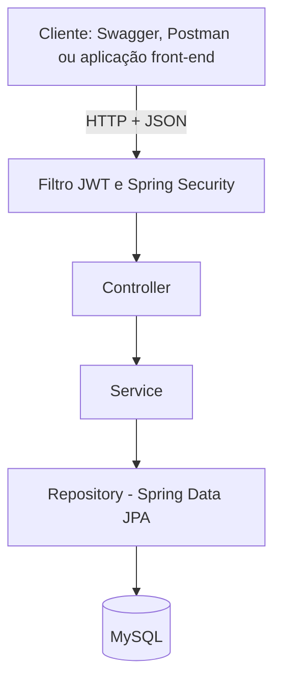
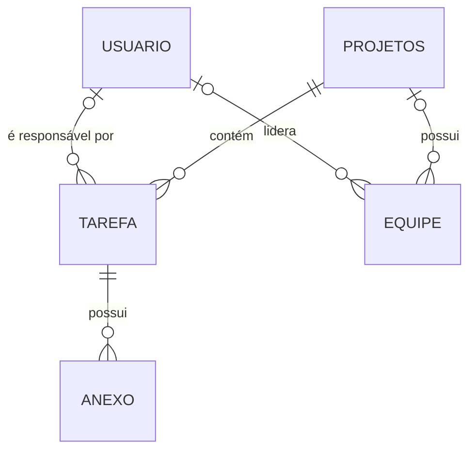
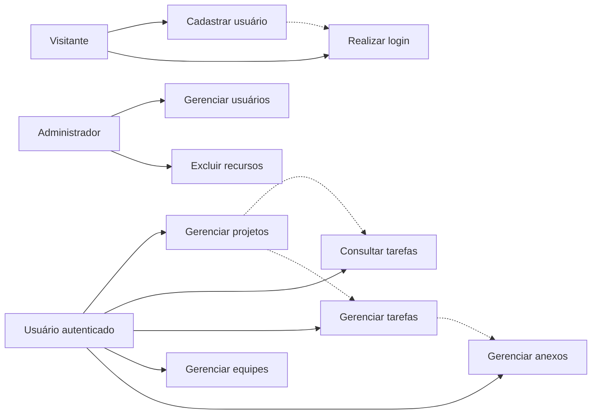

# Gerenciamento de Projetos

**Integrantes:**

- Alice Martins Miranda
- Arthur Souza Ribeiro
- Arthur Yuji Mendes Suzuki
- Felipe Souza de Jesus
- Luiz Miguel Mazega Lamas

## Objetivo

Desenvolver uma API REST que permita acompanhar o andamento de projetos em uma organização, reunindo em um só lugar os projetos, as tarefas, as equipes, os usuários responsáveis e os anexos de cada tarefa. O sistema oferece autenticação e controle de acesso por perfil, de modo que apenas usuários autorizados possam consultar ou alterar as informações.

Trabalho acadêmico desenvolvido na UNISALES, em Java com Spring Boot.

## Banco de dados

O projeto foi desenvolvido para MySQL 8, conforme a proposta da disciplina. O script de criação do banco (`Gerenciamentoprojeto.sql`), o driver `mysql-connector-j` e a configuração por variáveis de ambiente estão incluídos. O banco H2 em memória existe apenas como alternativa para executar a aplicação rapidamente, sem instalar nada, e é usado nos testes automatizados.

Para executar com MySQL, siga a seção [Configuração do MySQL](#configuração-do-mysql).

## Arquitetura

A aplicação é uma API REST monolítica, organizada em camadas, que segue o padrão do Spring MVC. Cada camada tem uma responsabilidade bem definida e se comunica apenas com a camada logo abaixo.



| Camada     | Responsabilidade                                                                  |
|------------|-----------------------------------------------------------------------------------|
| Security   | Autentica o usuário, gera e valida o token JWT e restringe o acesso por perfil    |
| Controller | Recebe as requisições HTTP, valida os dados de entrada e devolve as respostas     |
| DTO        | Define os dados que entram e saem da API, evitando expor as entidades diretamente |
| Service    | Concentra as regras de negócio                                                    |
| Repository | Acessa o banco de dados por meio do Spring Data JPA                               |
| Entity     | Representa as tabelas do banco (usuário, projeto, tarefa, equipe e anexo)         |
| Exception  | Trata os erros de forma centralizada e devolve mensagens padronizadas             |

**Modelo de dados**



A autenticação é stateless: não há sessão no servidor, e o cliente envia o token JWT em todas as requisições.

## Principais casos de uso



### UC-01 - Cadastrar usuário

- **Ator:** visitante ou administrador autenticado
- **Pré-condição:** o usuário informa nome, login e senha válidos.
- **Fluxo principal:**
  1. O ator envia uma requisição `POST /api/usuarios`.
  2. O sistema valida os campos obrigatórios e as regras de tamanho.
  3. O sistema verifica se ainda não existe nenhum usuário.
  4. O sistema criptografa a senha e salva o usuário.
  5. Quando não existe usuário anterior, o primeiro cadastro recebe o perfil `ADMIN`; os cadastros públicos seguintes recebem `USER`.
- **Fluxos alternativos:**
  - Um administrador autenticado pode informar o perfil de um novo usuário.
  - Dados inválidos retornam `400` com os erros por campo.
- **Pós-condição:** o usuário fica disponível para autenticação.

### UC-02 - Realizar login

- **Ator:** visitante
- **Pré-condição:** o usuário possui cadastro no sistema.
- **Fluxo principal:**
  1. O ator envia login e senha para `POST /api/auth/login`.
  2. O sistema valida as credenciais.
  3. O sistema gera um token JWT contendo o login e o perfil.
  4. O sistema informa o token, o tipo `Bearer` e o tempo de expiração.
- **Fluxos alternativos:**
  - Credenciais inválidas retornam `401`.
- **Pós-condição:** o usuário utiliza o token no cabeçalho `Authorization`.

### UC-03 - Gerenciar projetos

- **Ator:** usuário autenticado
- **Pré-condição:** o usuário possui um token JWT válido.
- **Fluxo principal:**
  1. O usuário cria um projeto com `POST /api/projetos`.
  2. O sistema valida os dados e salva o projeto.
  3. O usuário consulta projetos por meio de `GET /api/projetos`.
  4. O usuário pode consultar um projeto específico ou a listagem paginada e ordenada.
  5. O usuário atualiza um projeto existente com `PUT /api/projetos/{id}`.
- **Fluxos alternativos:**
  - Projeto inexistente retorna erro de recurso não encontrado.
  - Dados inválidos retornam `400`.
- **Pós-condição:** o projeto é criado ou atualizado e pode conter tarefas e equipes.
- **Regras específicas:** o campo `nome` é obrigatório e limitado a 255 caracteres.

### UC-04 - Consultar tarefas

- **Ator:** usuário autenticado
- **Pré-condição:** o projeto, a tarefa ou o responsável consultado existe.
- **Fluxo principal:**
  1. O usuário solicita a lista de tarefas em `GET /api/tarefas`.
  2. O sistema pode retornar todas as tarefas ou filtrar por `projetoId` ou `responsavelId`.
  3. O usuário também pode consultar todas as tarefas de um projeto em `GET /api/projetos/{id}/tarefas`.
- **Fluxos alternativos:**
  - Quando ambos os filtros são enviados em `/api/tarefas`, `projetoId` prevalece.
  - Projeto, responsável ou tarefa inexistente retorna erro de recurso não encontrado.
- **Pós-condição:** o usuário recebe as tarefas correspondentes aos filtros.

### UC-05 - Gerenciar tarefas

- **Ator:** usuário autenticado
- **Pré-condição:** o usuário está autenticado e o projeto referenciado existe.
- **Fluxo principal:**
  1. O usuário cria uma tarefa informando título, projeto e, opcionalmente, descrição, datas, prioridade, status e responsável.
  2. O sistema valida os dados e associa a tarefa ao projeto e ao responsável informados.
  3. O usuário consulta ou atualiza a tarefa.
- **Fluxos alternativos:**
  - Sem `idResponsavel`, a tarefa fica sem responsável definido.
  - Sem projeto existente, a criação ou atualização é recusada.
  - Dados inválidos retornam `400`.
- **Pós-condição:** a tarefa é criada ou atualizada no projeto.

### UC-06 - Gerenciar equipes

- **Ator:** usuário autenticado
- **Pré-condição:** o usuário está autenticado.
- **Fluxo principal:**
  1. O usuário cria uma equipe informando nome e, opcionalmente, descrição, projeto e líder.
  2. O sistema valida os usuários e projetos referenciados.
  3. O usuário consulta ou atualiza a equipe.
- **Fluxos alternativos:**
  - Projeto ou líder não informado é aceito.
  - Identificador inválido retorna erro de recurso não encontrado.
- **Pós-condição:** a equipe fica disponível com os vínculos informados.

### UC-07 - Gerenciar anexos

- **Ator:** usuário autenticado
- **Pré-condição:** a tarefa referenciada existe.
- **Fluxo principal:**
  1. O usuário cria um anexo com o identificador da tarefa, nome do arquivo, tipo, URL e, opcionalmente, usuário.
  2. O sistema valida os dados e associa o anexo à tarefa.
  3. O usuário consulta todos os anexos ou filtra por `tarefaId`.
  4. O usuário pode atualizar os dados ou a URL do anexo.
- **Fluxos alternativos:**
  - Somente a URL do arquivo é armazenada; o sistema não realiza upload do arquivo.
  - Tarefa ou usuário inexistente retorna erro de recurso não encontrado.
- **Pós-condição:** o anexo fica associado à tarefa.

### UC-08 - Gerenciar usuários

- **Ator:** administrador
- **Pré-condição:** o administrador está autenticado e a rota `/api/usuarios/**` exige o perfil `ADMIN`.
- **Fluxo principal:**
  1. O administrador consulta todos os usuários ou busca um usuário por identificador.
  2. O administrador atualiza dados e perfil do usuário.
  3. O administrador pode excluir usuários, exceto regras adicionais impostas pela política futura do sistema.
- **Fluxos alternativos:**
  - Usuário sem perfil administrativo recebe `403`.
  - Usuário não autenticado recebe `401`.
- **Pós-condição:** os dados e perfis dos usuários ficam atualizados.

### UC-09 - Excluir recursos

- **Ator:** administrador
- **Pré-condição:** o recurso existe e o usuário possui perfil `ADMIN`.
- **Fluxo principal:**
  1. O administrador envia uma requisição `DELETE` para `/api/projetos/{id}`, `/api/tarefas/{id}`, `/api/equipes/{id}` ou `/api/anexos/{id}`.
  2. O sistema verifica o perfil e localiza o recurso.
  3. O sistema remove o recurso e retorna `204`.
- **Fluxos alternativos:**
  - Usuário sem perfil administrativo recebe `403`.
  - Recurso inexistente retorna erro de recurso não encontrado.
- **Pós-condição:** o recurso é removido conforme as regras de integridade.
- **Regras específicas:**
  - Excluir projeto remove suas tarefas e os anexos dessas tarefas; as equipes permanecem sem vínculo com o projeto.
  - Excluir tarefa remove seus anexos.
  - Excluir usuário mantém suas tarefas e equipes, retirando os vínculos de responsável e líder.

## Funcionalidades

- Cadastro, consulta, atualização e exclusão de usuários, projetos, tarefas, equipes e anexos.
- Consulta de tarefas por projeto ou por responsável.
- Listagem paginada e ordenável de projetos.
- Validação dos dados de entrada, com mensagens de erro por campo.
- Autenticação por token JWT e controle de acesso por perfil (administrador e usuário comum).
- Documentação interativa via Swagger e collection do Postman.

## Tecnologias

- Java 21
- Spring Boot 4 (Web, Data JPA, Validation e Security)
- JWT (jjwt)
- MySQL 8 (banco principal) e H2 (execução rápida e testes)
- springdoc-openapi (Swagger)
- Maven
- JUnit 5 e Mockito

## Execução

São necessários o JDK 21 e o Maven. Para a execução rápida abaixo não é preciso instalar um banco de dados, pois ela usa o H2 em memória. Para usar o MySQL, veja a próxima seção.

```bash
git clone <url-do-repositorio>
cd Gerenciamento-de-Projetos/gerenciador-projetos
mvn spring-boot:run
```

A aplicação ficará disponível em `http://localhost:8080`, e a documentação do Swagger em `http://localhost:8080/swagger-ui.html`.

Sem nenhuma configuração, a aplicação utiliza o banco H2 em memória (modo de compatibilidade com MySQL). As tabelas são criadas automaticamente, mas os dados são perdidos sempre que a aplicação é encerrada. Para persistir os dados no MySQL, siga a seção abaixo.

### Configuração do MySQL

Para executar com o MySQL e manter os dados de forma persistente, crie o banco de dados com o script disponível na raiz do projeto:

```bash
mysql -u root -p < Gerenciamentoprojeto.sql
```

Em seguida, defina as variáveis de ambiente abaixo antes de iniciar a aplicação:

```bash
export DB_URL=jdbc:mysql://localhost:3306/gestao_projetos
export DB_USER=root
export DB_PASSWORD=sua_senha
export DB_DRIVER=com.mysql.cj.jdbc.Driver
export DB_DIALECT=org.hibernate.dialect.MySQLDialect
```

No Windows (PowerShell), utilize `$env:NOME="valor"` no lugar de `export NOME=valor`.

### Demais variáveis de ambiente

| Variável            | Valor padrão       | Descrição                                                                                         |
|---------------------|--------------------|---------------------------------------------------------------------------------------------------|
| `JWT_SECRET`        | chave de exemplo   | Chave utilizada para assinar os tokens. Deve ser alterada em produção e ter mais de 32 caracteres |
| `JWT_EXPIRATION_MS` | `3600000` (1 hora) | Tempo de validade do token, em milissegundos                                                      |

## Primeiros passos

1. Criar um usuário:
A rota de cadastro é pública. Como o banco inicia vazio, o primeiro usuário criado sem o campo `funcao` recebe automaticamente o perfil `ADMIN`.

```bash
curl -X POST http://localhost:8080/api/usuarios \
  -H "Content-Type: application/json" \
  -d '{"nome": "Administrador", "login": "admin", "senha": "admin123"}'
```

2. Realizar o login:
A resposta contém o campo `token`.

```bash
curl -X POST http://localhost:8080/api/auth/login \
  -H "Content-Type: application/json" \
  -d '{"login": "admin", "senha": "admin123"}'
```

3. Utilizar o token nas demais requisições:

```bash
curl http://localhost:8080/api/projetos \
  -H "Authorization: Bearer SEU_TOKEN_AQUI"
```

No Swagger, o token deve ser informado no botão Authorize, localizado no topo da página.

## Permissões de acesso

| Rota                                                   | Acesso                       |
|--------------------------------------------------------|------------------------------|
| Swagger, `POST /api/auth/login` e `POST /api/usuarios` | Público                      |
| Demais rotas de `/api/usuarios`                        | Somente `ADMIN`              |
| Qualquer requisição `DELETE`                           | Somente `ADMIN`              |
| Demais rotas                                           | Qualquer usuário autenticado |

Requisições sem token válido recebem o status `401`. Requisições autenticadas, mas sem permissão, recebem o status `403`.

## Endpoints

Todos os endpoints possuem o prefixo `/api`.

| Recurso       | Operações disponíveis                                                            |
|---------------|----------------------------------------------------------------------------------|
| `/usuarios`   | listar, buscar por id, criar, atualizar e excluir                                |
| `/projetos`   | as mesmas operações, além de `GET /paginado` e `GET /{id}/tarefas`               |
| `/tarefas`    | as mesmas operações. O `GET` aceita os filtros `?projetoId=` e `?responsavelId=` |
| `/equipes`    | as mesmas operações                                                              |
| `/anexos`     | as mesmas operações. O `GET` aceita o filtro `?tarefaId=`                        |
| `/auth/login` | `POST` que retorna o token de acesso                                             |

### Exemplo: criação de uma tarefa

```bash
curl -X POST http://localhost:8080/api/tarefas \
  -H "Authorization: Bearer SEU_TOKEN_AQUI" \
  -H "Content-Type: application/json" \
  -d '{
    "titulo": "Implementar login",
    "prazo": "2026-03-15",
    "prioridade": "Alta",
    "status": "A fazer",
    "idProjeto": 1,
    "idResponsavel": 1
  }'
```

### Exemplo: listagem paginada de projetos

```bash
curl -H "Authorization: Bearer SEU_TOKEN_AQUI" \
  "http://localhost:8080/api/projetos/paginado?pagina=0&tamanho=10&ordenarPor=idProjeto"
```

A numeração das páginas inicia em `0`. O parâmetro `ordenarPor` deve receber o nome de um atributo do projeto, como `idProjeto`, `nome` ou `dataInicio`.

## Campos obrigatórios

| Recurso | Obrigatórios                            | Observações                                                     |
|---------|-----------------------------------------|-----------------------------------------------------------------|
| Usuário | `nome`, `login`, `senha`                | O login deve ter entre 3 e 50 caracteres e a senha, no mínimo 6 |
| Projeto | `nome`                                  | Máximo de 255 caracteres                                        |
| Tarefa  | `titulo`, `idProjeto`                   | `idResponsavel` é opcional                                      |
| Equipe  | `nome`                                  | `idProjeto` e `idUsuario` (líder) são opcionais                 |
| Anexo   | `idTarefa`, `nomeArquivo`, `urlArquivo` | Apenas a URL do arquivo é armazenada                            |

Observações gerais:

- As datas seguem o formato `yyyy-MM-dd`.
- Os campos `status` e `prioridade` são de texto livre.
- A operação `PUT` substitui todos os campos, sendo necessário enviar o objeto completo (no caso de usuários, inclusive a senha).
- As listagens de usuários, projetos e equipes retornam dados resumidos. O registro completo é obtido pela busca por id.
- Em `/tarefas`, se `projetoId` e `responsavelId` forem enviados juntos, apenas `projetoId` é considerado.

## Comportamento na exclusão

- A exclusão de um projeto remove suas tarefas e os anexos dessas tarefas. As equipes são mantidas, apenas sem o vínculo com o projeto.
- A exclusão de uma tarefa remove os seus anexos.
- A exclusão de um usuário mantém suas tarefas e equipes, deixando o responsável ou líder em branco.

## Estrutura do projeto

```
Gerenciamento-de-Projetos/
├── Gerenciamentoprojeto.sql                        # script do banco de dados (MySQL)
├── Gerenciamento-Projetos.postman_collection.json  # requisições para o Postman
├── pom.xml
└── gerenciador-projetos/
    └── src/
        ├── main/java/br/unisales/gerenciador_projetos/
        │   ├── controller/   # rotas da API
        │   ├── service/      # regras de negócio
        │   ├── repository/   # acesso ao banco de dados
        │   ├── entity/       # entidades JPA
        │   ├── dto/          # objetos de entrada e saída
        │   ├── security/     # JWT e permissões
        │   ├── exception/    # tratamento de erros
        │   └── config/       # configuração do Swagger
        └── test/             # testes automatizados
```

## Testes

```bash
cd gerenciador-projetos
mvn test
```

Os testes cobrem os controllers (com MockMvc), os DTOs e os services de projeto e de usuário (com Mockito) e não dependem do MySQL. A autenticação e as permissões do Spring Security não são cobertas pelos testes atuais.
