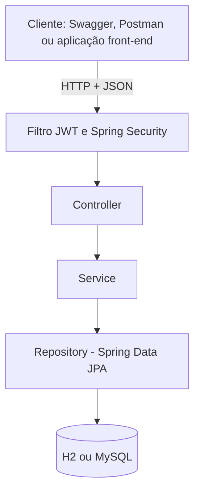
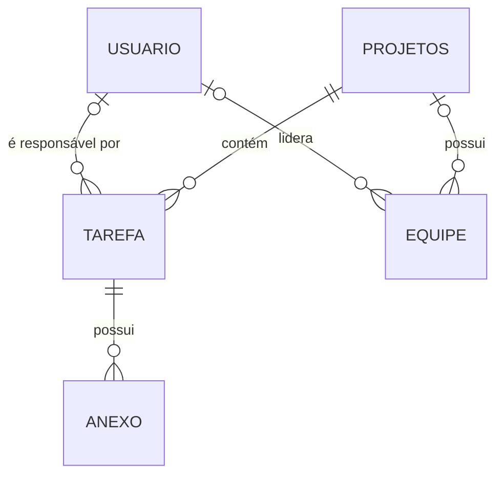

# Gerenciamento de Projetos

**Integrantes:**

- Alice Martins Miranda
- Arthur Souza Ribeiro
- Arthur Yuji Mendes Suzuki
- Felipe Souza de Jesus
- Luiz Miguel Mazega Lamas

## Objetivo

Desenvolver uma API REST que permita acompanhar o andamento de projetos em uma organização, reunindo em um só lugar os projetos, as tarefas, as equipes, os usuários responsáveis e os anexos de cada tarefa. O sistema oferece autenticação e controle de acesso por perfil, de modo que apenas usuários autorizados possam consultar ou alterar as informações.

Trabalho acadêmico desenvolvido na UNISALES, em Java com Spring Boot.

## Arquitetura

A aplicação é uma API REST monolítica, organizada em camadas, que segue o padrão do Spring MVC. Cada camada tem uma responsabilidade bem definida e se comunica apenas com a camada logo abaixo.



| Camada     | Responsabilidade                                                                  |
|------------|-----------------------------------------------------------------------------------|
| Security   | Autentica o usuário, gera e valida o token JWT e restringe o acesso por perfil    |
| Controller | Recebe as requisições HTTP, valida os dados de entrada e devolve as respostas     |
| DTO        | Define os dados que entram e saem da API, evitando expor as entidades diretamente |
| Service    | Concentra as regras de negócio                                                    |
| Repository | Acessa o banco de dados por meio do Spring Data JPA                               |
| Entity     | Representa as tabelas do banco (usuário, projeto, tarefa, equipe e anexo)         |
| Exception  | Trata os erros de forma centralizada e devolve mensagens padronizadas             |

**Modelo de dados**



A autenticação é stateless: não há sessão no servidor, e o cliente envia o token JWT em todas as requisições.

## Principais casos de uso

| Ator                | Caso de uso                                                                             |
|---------------------|-----------------------------------------------------------------------------------------|
| Visitante           | Cadastrar-se no sistema                                                                 |
| Visitante           | Realizar login e obter o token de acesso                                                |
| Usuário autenticado | Criar, consultar e atualizar projetos                                                   |
| Usuário autenticado | Listar projetos de forma paginada e ordenada                                            |
| Usuário autenticado | Criar, consultar e atualizar tarefas, definindo prazo, prioridade, status e responsável |
| Usuário autenticado | Consultar as tarefas de um projeto ou de um responsável                                 |
| Usuário autenticado | Criar, consultar e atualizar equipes, indicando o projeto e o líder                     |
| Usuário autenticado | Anexar um arquivo (por URL) a uma tarefa e consultar os anexos                          |
| Administrador       | Gerenciar os usuários do sistema e definir seus perfis                                  |
| Administrador       | Excluir projetos, tarefas, equipes e anexos                                             |

## Funcionalidades

- Cadastro, consulta, atualização e exclusão de usuários, projetos, tarefas, equipes e anexos.
- Consulta de tarefas por projeto ou por responsável.
- Listagem paginada e ordenável de projetos.
- Validação dos dados de entrada, com mensagens de erro por campo.
- Autenticação por token JWT e controle de acesso por perfil (administrador e usuário comum).
- Documentação interativa via Swagger e collection do Postman.

## Tecnologias

- Java 21
- Spring Boot 4 (Web, Data JPA, Validation e Security)
- JWT (jjwt)
- H2 (padrão) ou MySQL 8
- springdoc-openapi (Swagger)
- Maven
- JUnit 5 e Mockito

## Execução

São necessários o JDK 21 e o Maven. Não é preciso instalar um banco de dados para executar o projeto.

```bash
git clone <url-do-repositorio>
cd Gerenciamento-de-Projetos/gerenciador-projetos
mvn spring-boot:run
```

A aplicação ficará disponível em `http://localhost:8080`, e a documentação do Swagger em `http://localhost:8080/swagger-ui.html`.

Por padrão, a aplicação utiliza o banco H2 em memória. As tabelas são criadas automaticamente, mas os dados são perdidos sempre que a aplicação é encerrada.

### Configuração do MySQL (opcional)

Para manter os dados de forma persistente, crie o banco de dados com o script disponível na raiz do projeto:

```bash
mysql -u root -p < Gerenciamentoprojeto.sql
```

Em seguida, defina as variáveis de ambiente abaixo antes de iniciar a aplicação:

```bash
export DB_URL=jdbc:mysql://localhost:3306/gestao_projetos
export DB_USER=root
export DB_PASSWORD=sua_senha
export DB_DRIVER=com.mysql.cj.jdbc.Driver
export DB_DIALECT=org.hibernate.dialect.MySQLDialect
```

No Windows (PowerShell), utilize `$env:NOME="valor"` no lugar de `export NOME=valor`.

### Demais variáveis de ambiente

| Variável            | Valor padrão       | Descrição                                                                                         |
|---------------------|--------------------|---------------------------------------------------------------------------------------------------|
| `JWT_SECRET`        | chave de exemplo   | Chave utilizada para assinar os tokens. Deve ser alterada em produção e ter mais de 32 caracteres |
| `JWT_EXPIRATION_MS` | `3600000` (1 hora) | Tempo de validade do token, em milissegundos                                                      |

## Primeiros passos

1. Criar um usuário:
A rota de cadastro é pública. Como o banco inicia vazio, o primeiro usuário criado sem o campo `funcao` recebe automaticamente o perfil `ADMIN`.

```bash
curl -X POST http://localhost:8080/api/usuarios \
  -H "Content-Type: application/json" \
  -d '{"nome": "Administrador", "login": "admin", "senha": "admin123"}'
```

2. Realizar o login:
A resposta contém o campo `token`.

```bash
curl -X POST http://localhost:8080/api/auth/login \
  -H "Content-Type: application/json" \
  -d '{"login": "admin", "senha": "admin123"}'
```

3. Utilizar o token nas demais requisições:

```bash
curl http://localhost:8080/api/projetos \
  -H "Authorization: Bearer SEU_TOKEN_AQUI"
```

No Swagger, o token deve ser informado no botão Authorize, localizado no topo da página.

## Permissões de acesso

| Rota                                                   | Acesso                       |
|--------------------------------------------------------|------------------------------|
| Swagger, `POST /api/auth/login` e `POST /api/usuarios` | Público                      |
| Demais rotas de `/api/usuarios`                        | Somente `ADMIN`              |
| Qualquer requisição `DELETE`                           | Somente `ADMIN`              |
| Demais rotas                                           | Qualquer usuário autenticado |

Requisições sem token válido recebem o status `401`. Requisições autenticadas, mas sem permissão, recebem o status `403`.

## Endpoints

Todos os endpoints possuem o prefixo `/api`.

| Recurso       | Operações disponíveis                                                            |
|---------------|----------------------------------------------------------------------------------|
| `/usuarios`   | listar, buscar por id, criar, atualizar e excluir                                |
| `/projetos`   | as mesmas operações, além de `GET /paginado` e `GET /{id}/tarefas`               |
| `/tarefas`    | as mesmas operações. O `GET` aceita os filtros `?projetoId=` e `?responsavelId=` |
| `/equipes`    | as mesmas operações                                                              |
| `/anexos`     | as mesmas operações. O `GET` aceita o filtro `?tarefaId=`                        |
| `/auth/login` | `POST` que retorna o token de acesso                                             |

### Exemplo: criação de uma tarefa

```bash
curl -X POST http://localhost:8080/api/tarefas \
  -H "Authorization: Bearer SEU_TOKEN_AQUI" \
  -H "Content-Type: application/json" \
  -d '{
    "titulo": "Implementar login",
    "prazo": "2026-03-15",
    "prioridade": "Alta",
    "status": "A fazer",
    "idProjeto": 1,
    "idResponsavel": 1
  }'
```

### Exemplo: listagem paginada de projetos

```bash
curl -H "Authorization: Bearer SEU_TOKEN_AQUI" \
  "http://localhost:8080/api/projetos/paginado?pagina=0&tamanho=10&ordenarPor=idProjeto"
```

A numeração das páginas inicia em `0`. O parâmetro `ordenarPor` deve receber o nome de um atributo do projeto, como `idProjeto`, `nome` ou `dataInicio`.

## Campos obrigatórios

| Recurso | Obrigatórios                            | Observações                                                     |
|---------|-----------------------------------------|-----------------------------------------------------------------|
| Usuário | `nome`, `login`, `senha`                | O login deve ter entre 3 e 50 caracteres e a senha, no mínimo 6 |
| Projeto | `nome`                                  | Máximo de 255 caracteres                                        |
| Tarefa  | `titulo`, `idProjeto`                   | `idResponsavel` é opcional                                      |
| Equipe  | `nome`                                  | `idProjeto` e `idUsuario` (líder) são opcionais                 |
| Anexo   | `idTarefa`, `nomeArquivo`, `urlArquivo` | Apenas a URL do arquivo é armazenada                            |

Observações gerais:

- As datas seguem o formato `yyyy-MM-dd`.
- Os campos `status` e `prioridade` são de texto livre.
- A operação `PUT` substitui todos os campos, sendo necessário enviar o objeto completo (no caso de usuários, inclusive a senha).
- As listagens de usuários, projetos e equipes retornam dados resumidos. O registro completo é obtido pela busca por id.
- Em `/tarefas`, se `projetoId` e `responsavelId` forem enviados juntos, apenas `projetoId` é considerado.

## Comportamento na exclusão

- A exclusão de um projeto remove suas tarefas e os anexos dessas tarefas. As equipes são mantidas, apenas sem o vínculo com o projeto.
- A exclusão de uma tarefa remove os seus anexos.
- A exclusão de um usuário mantém suas tarefas e equipes, deixando o responsável ou líder em branco.

## Estrutura do projeto

```
Gerenciamento-de-Projetos/
├── Gerenciamentoprojeto.sql                        # script do banco de dados (MySQL)
├── Gerenciamento-Projetos.postman_collection.json  # requisições para o Postman
├── pom.xml
└── gerenciador-projetos/
    └── src/
        ├── main/java/br/unisales/gerenciador_projetos/
        │   ├── controller/   # rotas da API
        │   ├── service/      # regras de negócio
        │   ├── repository/   # acesso ao banco de dados
        │   ├── entity/       # entidades JPA
        │   ├── dto/          # objetos de entrada e saída
        │   ├── security/     # JWT e permissões
        │   ├── exception/    # tratamento de erros
        │   └── config/       # configuração do Swagger
        └── test/             # testes automatizados
```

## Testes

```bash
cd gerenciador-projetos
mvn test
```

Os testes cobrem os controllers (com MockMvc), os DTOs e os services de projeto e de usuário (com Mockito) e não dependem do MySQL. A autenticação e as permissões do Spring Security não são cobertas pelos testes atuais.
